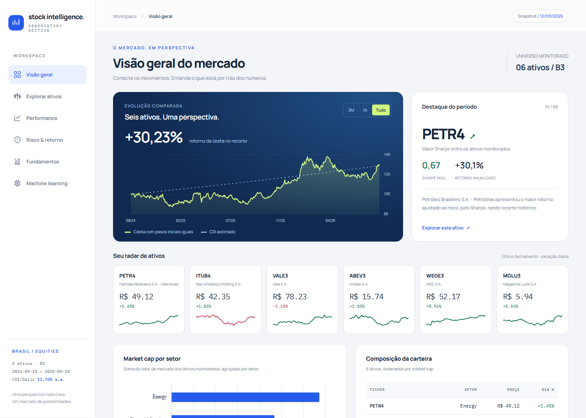
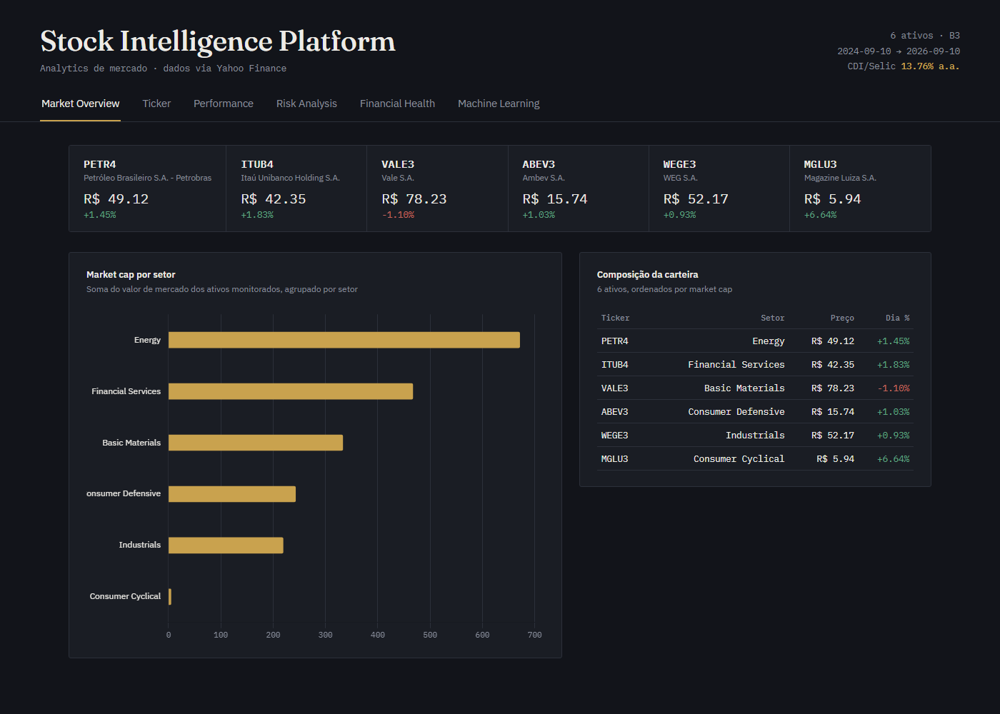
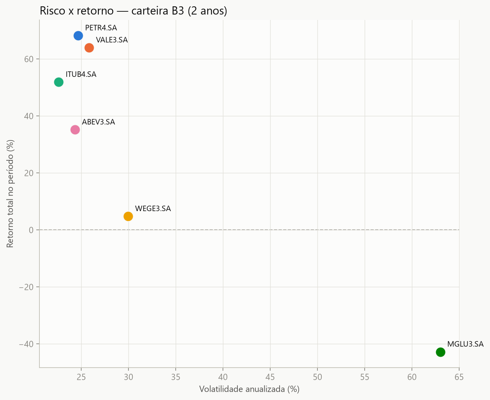
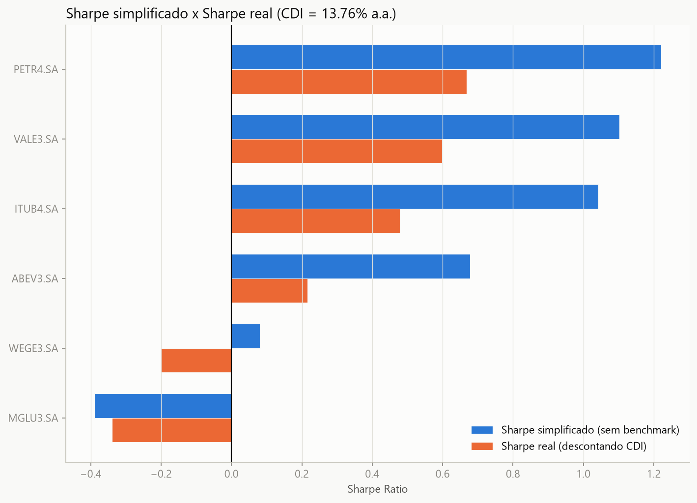

# Stock Intelligence Platform

Projeto de aprendizado sobre dados de mercado de ações: coleta via API
(Yahoo Finance), modelagem em esquema estrela (fato/dimensões), carga num
banco SQL e análise de risco/retorno de uma carteira de ações da B3.

## Dashboards

**Observatory** (`output/dashboard_observatory.html`): visão geral do mercado, radar de ativos, risco/retorno, fundamentos e machine learning.



**Dashboard clássico** (`output/dashboard.html`):



## Análises

| Risco x retorno | Sharpe simplificado x real |
|---|---|
|  |  |

Para ver os dashboards interativos, baixe o repositório e abra os arquivos `.html` em `output/` no navegador.

## Estrutura

```
Stock-Intelligence-Platform/
├── output/                       # CSVs gerados pela coleta e pelas análises
├── plots/                        # Gráficos gerados a partir dos dados
├── schema.sql                    # Definição das 3 tabelas (fato_preco, dim_empresa, dim_tempo)
├── stock_intelligence.db         # Banco SQLite carregado a partir do schema + CSVs
├── 01_coleta_yfinance.py         # Etapa 1: coleta via yfinance
├── 02_eda_precos.py              # Etapa 2: análise exploratória de preços/retornos
├── 02_indicadores_tecnicos.py    # Médias móveis (20/50/200) e RSI(14) por ticker
├── 03_sharpe_real.py             # Sharpe Ratio descontando CDI/Selic (refina a Etapa 2)
├── 03_carga_banco.py             # Etapa 3: carga do schema.sql + CSVs no banco
├── 04_comparacao_sharpe.py       # Gráfico: Sharpe simplificado x Sharpe real
├── 04_gerar_dashboard.py         # Gera output/dashboard.html a partir do template
├── dashboard_template.html       # Template do dashboard (placeholder __DATA_JSON__)
├── 05_coleta_fundamentos.py      # Financial Health: múltiplos, rentabilidade, endividamento
├── 06_modelo_ml.py               # Classificação binária (bate CDI em 20 dias?), split único
└── 07_walkforward_ml.py          # Mesmo experimento do 06, validado em 5 folds de janela expansiva
```

## Dados (`output/`)

Modelo em esquema estrela, carregado no banco SQL a partir de `schema.sql`:

| Arquivo | Descrição |
|---|---|
| `fato_preco.csv` | Uma linha por (data, ticker): abertura, máxima, mínima, fechamento, volume e retorno diário. |
| `dim_empresa.csv` | Cadastro por ticker: nome, setor, país, market cap (via `yfinance`). |
| `dim_tempo.csv` | Datas únicas de `fato_preco`, com ano/mês/trimestre derivados — sem chamada extra à API. |
| `sharpe_real.csv` | Saída de `03_sharpe_real.py`: retorno anualizado, volatilidade, excesso sobre CDI e Sharpe Ratio por ticker. |
| `dim_fundamentos.csv` | Saída de `05_coleta_fundamentos.py`: P/L, P/VP, ROE, ROA, margens, dívida/patrimônio, liquidez corrente, dividend yield e crescimento de receita por ticker. Tabela separada de `dim_empresa` de propósito — fundamentos mudam por trimestre, cadastro/preço mudam por dia. |
| `fato_preco_com_indicadores.csv` | Saída de `02_indicadores_tecnicos.py`: `fato_preco.csv` enriquecido com `mm20`/`mm50`/`mm200` e `rsi14` por ticker. Base de features para `06_modelo_ml.py`/`07_walkforward_ml.py`. |
| `previsoes_ml.csv` | Saída de `06_modelo_ml.py`: previsões do XGBoost (melhor modelo por ROC-AUC no split único) no conjunto de teste, com o retorno futuro real ao lado para inspeção. |
| `split_unico_resultados.csv` | Saída de `06_modelo_ml.py`: acurácia/F1/ROC-AUC dos 3 modelos num único corte treino/teste. |
| `walkforward_resultados.csv` | Saída de `07_walkforward_ml.py`: acurácia/F1/ROC-AUC dos 3 modelos em cada um dos 5 folds de janela expansiva. |

**Carteira coletada** (6 tickers B3, um por setor, para permitir comparação
setorial): PETR4.SA (Energy), VALE3.SA (Basic Materials), ITUB4.SA
(Financial Services), WEGE3.SA (Industrials), ABEV3.SA (Consumer Defensive),
MGLU3.SA (Consumer Cyclical).

**Cobertura**: 2 anos de dados diários (2024-09-10 a 2026-09-10), 2.994
linhas em `fato_preco` (499 dias úteis × 6 tickers, sem duplicatas e sem
nenhum ticker faltando dias). Os únicos valores nulos são os 6 esperados em
`retorno_diario` (1 por ticker, no primeiro dia da série — não há dia
anterior pra calcular variação).

## Como rodar

```bash
git clone https://github.com/JoaoJordao27/stock-intelligence-platform.git
cd stock-intelligence-platform
python -m venv .venv
.venv\Scripts\activate        # Windows
pip install -r requirements.txt

python 01_coleta_yfinance.py  # e siga a ordem numérica dos scripts
```

Os CSVs, o banco SQLite e os dashboards já estão em `output/` e `stock_intelligence.db`, então dá para explorar os resultados sem rodar a coleta.

## Tecnologias

Python · pandas · yfinance · SQLite · scikit-learn · XGBoost · matplotlib

## Origem

Dados baixados ao vivo via `yfinance` (Yahoo Finance), não é um dataset
estático do Kaggle — reflete o mercado no momento em que o script rodou.
Rodar `01_coleta_yfinance.py` de novo mais tarde vai trazer preços/retornos
diferentes (é mercado real, não um snapshot fixo).

## Análises já feitas

### `01_coleta_yfinance.py`

Coleta preços (`yf.Ticker(ticker).history`) e cadastro (`yf.Ticker(ticker).info`)
dos 6 tickers, monta as 3 tabelas do esquema estrela e salva em `output/`.

Rodar com:
```
python 01_coleta_yfinance.py
```

### `02_eda_precos.py`

Explora os dados coletados: consistência, evolução de preço, distribuição
de retornos diários, risco x retorno e correlação entre os tickers.

Gera:

1. Checagem de consistência (nulos, duplicatas, período coberto).
2. Evolução de preço normalizado (rebase = 100 no início) →
   `plots/preco_normalizado.png`
3. Distribuição dos retornos diários por ticker (boxplot) →
   `plots/distribuicao_retornos.png`
4. Risco (volatilidade anualizada) x retorno total no período (scatter) →
   `plots/risco_x_retorno.png`
5. Correlação entre os retornos diários da carteira (heatmap) →
   `plots/correlacao_retornos.png`

Rodar com:
```
python 02_eda_precos.py
```

#### Conclusões

- **Dados limpos**: 2.994 linhas, 0 duplicatas, exatamente 499 dias para
  cada um dos 6 tickers, e os únicos nulos são os 6 esperados (1º dia de
  cada série, sem dia anterior pra calcular retorno).

- **MGLU3.SA é um outlier extremo na carteira**: caiu **-42.8%** no período
  (única ação no vermelho) com volatilidade anualizada de **63.0%** — mais
  que o dobro de qualquer outra ação da carteira (a 2ª mais volátil,
  WEGE3.SA, tem 30.0%). O gráfico de risco x retorno deixa isso muito claro:
  MGLU3.SA fica isolada no canto de "muito risco, retorno negativo" —
  exatamente o quadrante que ninguém quer numa carteira.

- **Ranking de retorno no período**: PETR4.SA (+68.2%) e VALE3.SA (+64.0%)
  lideraram, seguidas por ITUB4.SA (+51.9%) e ABEV3.SA (+35.2%). WEGE3.SA
  ficou praticamente estável (+4.8%). Interessante que as duas maiores altas
  (Petrobras e Vale, commodities/estatal) tiveram volatilidade parecida às
  ações mais "estáveis" do setor financeiro/consumo (22-26%) — ou seja,
  nessa carteira e nesse período, retorno alto não veio necessariamente
  acompanhado de mais risco (exceto no caso oposto do MGLU3.SA).

- **Correlações são todas positivas mas fracas a moderadas** (0.03 a 0.51)
  — nenhum par se move em conjunto de forma forte, o que é bom sinal de
  diversificação setorial (o objetivo de ter 1 ticker por setor parece ter
  funcionado). O par mais correlacionado foi ITUB4.SA x MGLU3.SA (0.51) e o
  menos correlacionado foi PETR4.SA x WEGE3.SA (0.03) — praticamente
  independentes uma da outra.

### `03_sharpe_real.py`

Refina a leitura de risco x retorno da Etapa 2: em vez do Sharpe
simplificado (retorno/volatilidade, sem descontar nada), calcula o **Sharpe
Ratio de verdade** — excesso de retorno sobre a taxa livre de risco
(CDI/Selic), dividido pela volatilidade anualizada. Sem esse desconto, uma
ação que só empatou com a poupança/CDI parece "positiva"; com o desconto,
fica claro que ela teria sido pior que não correr risco nenhum.

A taxa livre de risco (`RF_ANUAL = 13.76%`) é uma média anualizada da Selic
do período coletado, hardcoded a partir das taxas mensais do Banco Central
(bcb.gov.br) — nota do próprio script: para uso real, trocar por uma
consulta à série histórica 4390 da API do BC (CDI diário) e calcular o
excesso de retorno dia a dia em vez de usar uma média fixa do período.

Gera: `output/sharpe_real.csv`

Rodar com (a partir da raiz do projeto, já que os caminhos são relativos):
```
python 03_sharpe_real.py
```

*(Nota: o nome coincide com `03_carga_banco.py` — são scripts independentes,
sem relação de dependência entre si; ambos ficaram com prefixo `03_` por
terem sido escritos em paralelo.)*

#### Conclusões

| Ticker | Retorno anualizado | Vol. anualizada | Excesso s/ CDI | Sharpe real |
|---|---|---|---|---|
| PETR4.SA | +30.11% | 24.66% | **+16.35 p.p.** | **0.67** |
| VALE3.SA | +28.44% | 25.82% | +14.68 p.p. | 0.60 |
| ITUB4.SA | +23.56% | 22.61% | +9.80 p.p. | 0.48 |
| ABEV3.SA | +16.49% | 24.33% | +2.73 p.p. | 0.22 |
| WEGE3.SA | +2.40% | 29.96% | -11.36 p.p. | **-0.20** |
| MGLU3.SA | -24.60% | 63.00% | -38.36 p.p. | **-0.34** |

- **A volatilidade anualizada bate quase exatamente com a da Etapa 2**
  (PETR4 24.66% vs. 24.7%, MGLU3 63.00% vs. 63.0%, etc.) — boa validação
  cruzada entre os dois scripts, calculando a mesma coisa de formas
  ligeiramente diferentes e chegando ao mesmo número.

- **O CDI muda a leitura de "quem performou bem"**: com a Selic rodando a
  13.76% ao ano no período — uma taxa livre de risco muito alta pros padrões
  internacionais —, **WEGE3.SA vira Sharpe negativo (-0.20)**, mesmo tendo
  fechado o período no positivo (+2.40% anualizado). Ou seja: quem comprou
  WEGE3.SA e segurou por 2 anos teria ficado **11.36 pontos percentuais pior
  por ano** do que simplesmente deixado o dinheiro rendendo CDI, sem
  nenhum risco. É o tipo de conclusão que só aparece quando se compara com
  um benchmark de verdade — olhando só o retorno bruto da Etapa 2 (+4.8%),
  WEGE3.SA parecia "modesta mas positiva"; com o benchmark, foi uma escolha
  ruim.

- **PETR4.SA segue como a melhor posição da carteira**, agora com uma
  métrica que pondera risco e custo de oportunidade, não só retorno bruto —
  Sharpe 0.67, o maior excesso sobre o CDI (+16.35 p.p./ano) pela
  volatilidade que exigiu.

- **MGLU3.SA continua a pior posição, de forma ainda mais grave** com o
  benchmark: não bastou perder dinheiro em termos absolutos (-24.60% ao
  ano), perdeu **38.36 pontos percentuais ao ano** em relação a uma
  alternativa sem risco — o pior Sharpe da carteira (-0.34) por uma margem
  clara.

### `04_comparacao_sharpe.py`

Visualiza lado a lado o Sharpe simplificado (retorno/vol, sem benchmark) e o
Sharpe real (descontando CDI) de cada ticker — o gráfico que faltava pra
enxergar de uma vez só o quanto o benchmark muda a leitura de performance.
Recalcula as duas métricas direto de `fato_preco.csv` (mesmas fórmulas de
`03_sharpe_real.py`) em vez de importar o outro script — módulo com nome
começando em dígito não é importável via `import` no Python.

Gera: `plots/comparacao_sharpe.png`

Rodar com:
```
python 04_comparacao_sharpe.py
```

#### Conclusões

- **Todo ticker piora ao trocar simplificado por real** (esperado — CDI a
  13.76% a.a. é um piso alto de comparação), mas a QUEDA não é uniforme:
  PETR4.SA cai 0.55 (de 1.22 para 0.67), ITUB4.SA cai ainda mais em termos
  absolutos (0.56, de 1.04 para 0.48) — ou seja, o benchmark penaliza mais
  quem tinha uma volatilidade menor pra "absorver" o desconto (ITUB4.SA tem
  a 2ª menor vol da carteira, 22.6%).

- **WEGE3.SA é o único ticker que muda de sinal**: Sharpe simplificado
  levemente positivo (+0.08) vira Sharpe real negativo (-0.20) — visualmente,
  é a única barra laranja que cruza pro lado esquerdo do zero no gráfico.
  Confirma numericamente o achado da seção anterior.

- **MGLU3.SA é o único ticker que "melhora" (fica menos negativo)** ao
  trocar pra Sharpe real (-0.39 -> -0.34, diferença de apenas -0.05,
  sinal invertido dos outros 5 tickers) — não porque foi um bom investimento
  descontado o CDI, mas porque sua volatilidade é tão alta (63%) que o
  desconto do CDI vira proporcionalmente pequeno perto do tamanho da queda
  que já tinha. É um lembrete de que Sharpe muito negativo já sinaliza
  "problema grave" antes mesmo de entrar o benchmark.

### `schema.sql` + `03_carga_banco.py`

`schema.sql` define as 3 tabelas do esquema estrela — `dim_empresa`
(`PRIMARY KEY ticker`), `dim_tempo` (`PRIMARY KEY data`) e `fato_preco`
(`PRIMARY KEY (data, ticker)`, com `FOREIGN KEY` pra `dim_empresa.ticker` e
`dim_tempo.data`). `03_carga_banco.py` cria o banco a partir desse schema e
carrega os 3 CSVs de `output/`.

**Ordem de criação/carga importa por causa das FKs**: as dimensões
(`dim_empresa`, `dim_tempo`) são criadas e carregadas ANTES de `fato_preco`
— senão o banco rejeitaria a FK por apontar pra uma tabela/linha que ainda
não existe. Ao dropar (pra recriar do zero), a ordem é invertida:
`fato_preco` primeiro, dimensões depois.

**Motor de banco: SQLite** (`stock_intelligence.db`, arquivo local neste
diretório) — escolhido por ser o padrão mais simples pra um projeto local
sem servidor configurado, só a biblioteca padrão do Python
(`sqlite3`). `schema.sql` é SQL padrão (sem nada específico de motor), então
serve de base sem alterações se o projeto migrar pra Postgres/MySQL depois —
só trocaria a camada de conexão no script.

O script é **idempotente**: roda `DROP TABLE IF EXISTS` antes de recriar,
então pode ser executado de novo (ex. depois de atualizar os dados na Etapa
1) sem duplicar linhas nem falhar por tabela já existir.

Rodar com:
```
python 03_carga_banco.py
```

#### Conclusões

- **Carga sem perda de dados**: as contagens batem exatamente com os CSVs de
  origem — 2.994 linhas em `fato_preco`, 6 em `dim_empresa`, 499 em
  `dim_tempo`. Nenhuma linha rejeitada ou duplicada.

- **Os joins confirmam que o modelo relacional funciona de verdade**, não só
  que os `INSERT`s não deram erro. A query de retorno médio por setor
  (`fato_preco` JOIN `dim_empresa`) reproduz exatamente o que a Etapa 2 já
  tinha mostrado via pandas — Energy no topo (+0.117%/dia em média),
  Consumer Cyclical no fundo e único setor negativo (-0.034%/dia, arrastado
  pelo MGLU3.SA, o único ticker desse setor na carteira). Isso é uma boa
  validação cruzada: duas ferramentas diferentes (pandas e SQL) chegando à
  mesma conclusão a partir dos mesmos dados brutos.

- **FK realmente aplicada, não só declarada**: `03_carga_banco.py` testa
  isso na prática — tenta inserir uma linha em `fato_preco` com um ticker
  que não existe em `dim_empresa`, e o SQLite rejeita com
  `FOREIGN KEY constraint failed`. Importante lembrar que o SQLite, ao
  contrário da maioria dos bancos, **ignora `FOREIGN KEY` por padrão** a
  menos que `PRAGMA foreign_keys = ON` seja ligado por conexão — o script já
  faz isso logo depois de conectar, mas é um detalhe fácil de esquecer numa
  conexão nova/manual (ex. abrindo o `.db` direto num cliente SQLite).

- **Idempotência confirmada mesmo com as chaves**: rodar o script duas vezes
  seguidas não duplica nem falha — o `PRIMARY KEY` agora reforça no nível do
  banco o que antes dependia só do `DROP TABLE IF EXISTS` do script.

### `04_gerar_dashboard.py` + `dashboard_template.html`

Gera um dashboard HTML único e estático (`output/dashboard.html`) — sem
servidor, abre direto no navegador (`file://`). `04_gerar_dashboard.py` lê
`fato_preco.csv`, `dim_empresa.csv`, `sharpe_real.csv` e (se existir)
`dim_fundamentos.csv`, monta um objeto com tudo que a página precisa e
injeta como JSON dentro de `dashboard_template.html` no lugar do placeholder
`__DATA_JSON__`.

O template passou por 4 versões, cada uma documentada aqui porque cada troca
teve um motivo real:

1. **v1**: gráfico de linha via Chart.js (CDN). Quebrava a página inteira —
   testando com Chrome headless (sandbox sem acesso de rede no momento), o
   gráfico, o heatmap E a tabela vinham em branco, porque `Chart` ficava
   `undefined`, o `new Chart(...)` lançava erro, e tudo que vinha depois no
   mesmo `<script>` nunca executava.
2. **v2**: reescrevi o gráfico como SVG nativo em JS puro, sem dependência
   de rede — corrigia o bug acima e funcionava 100% offline. Publiquei essa
   versão como Artifact.
3. **v3**: redesign completo, com layout em abas (**Market Overview**,
   **Performance**, **Risk Analysis**, **Financial Health**), Chart.js
   reintroduzido deliberadamente (barra, linha, dispersão com plugin de
   rótulo customizado — recursos que dariam muito mais trabalho pra
   reimplementar à mão em SVG), tipografia Fraunces + IBM Plex Sans/Mono e
   paleta escura própria (dourado/verde/vermelho). A aba **Financial
   Health** consome `dim_fundamentos.csv` (Etapa 5): dispersão ROE × P/L e
   barras de margem líquida.
4. **v4**: nova aba **Machine Learning**, consumindo
   `split_unico_resultados.csv` e `walkforward_resultados.csv` (Etapas 6 e
   7) — barra comparando ROC-AUC do split único x média walk-forward por
   modelo, linha com ROC-AUC por fold (referência pontilhada em 0,50) e um
   texto de leitura gerado com os números reais (melhor modelo, média,
   desvio-padrão). `04_gerar_dashboard.py` só monta a chave `ml` no JSON se
   os dois CSVs existirem (`Path(...).exists()`), então o dashboard
   continua funcionando normalmente mesmo sem a Etapa 6/7 já ter rodado.
5. **v5 (atual)**: nova aba **Ticker**, com um `<select>` que troca em
   tempo real (sem reload, tudo client-side) qual ativo está em foco —
   card de estatísticas (preço, Sharpe, retorno a.a., vol. a.a., RSI com
   selo de sobrecomprado/sobrevendido/neutro), gráfico de preço com
   MM20/50/200 sobrepostas e gráfico de RSI(14) com faixas sombreadas
   acima de 70/abaixo de 30. Consome `mm20`/`mm50`/`mm200`/`rsi14` de
   `fato_preco_com_indicadores.csv` (Etapa 2, gerados por
   `02_indicadores_tecnicos.py`) — até então calculados mas nunca
   mostrados no dashboard. Os 4 gráficos de Chart.js (preço) são criados
   uma única vez; trocar o ativo só atualiza `chart.data.datasets[i].data`
   e chama `chart.update()`, em vez de destruir/recriar os gráficos —
   mais rápido e evita vazamento de instâncias do Chart.js.

Rodar de novo sempre que os dados forem atualizados (nova rodada da Etapa 1
e/ou 5):
```
python 04_gerar_dashboard.py
```

#### Conclusões

- **A "lição" da v2 sobre nunca depender de CDN era exagerada** — reavaliei
  ao testar a v3: o bloqueio de rede que quebrou o Chart.js na v1 era uma
  limitação da MINHA ferramenta de verificação (Chrome headless rodando
  dentro de um sandbox de execução de comandos, sem saída de rede liberada
  naquele momento), não um problema do dashboard em si. Testei a v3 do
  mesmo jeito (Chrome headless + screenshot) e desta vez `cdnjs.cloudflare.com`
  respondeu normalmente — o gráfico de barras (`Market cap por setor`)
  renderizou certinho. Pro navegador de um usuário real (ou pro Artifact,
  que tem `cdnjs.cloudflare.com` na lista de CDNs permitidas), isso nunca
  foi um problema de verdade. Registro isso pra não repetir a mesma
  conclusão precipitada da vez passada.

- **Validação estrutural do JSON**: conferi que os 6 tickers, agora com os
  10 campos de `dim_fundamentos` mesclados, chegam certinho no HTML final
  (sem sobrar nenhum placeholder `__DATA_JSON__`) — a lógica de merge em
  `montar_dados()` (usar `.get()` com fallback `None`/`NaN→None` pros 2
  campos ausentes de ITUB4.SA) funciona sem quebrar a serialização.

- **Só verifiquei visualmente a aba "Market Overview"** (a que abre por
  padrão) — um screenshot estático não navega pelas outras abas. As demais
  (Performance, Risk Analysis, Financial Health) foram conferidas por
  leitura de código, não visualmente.

- **Adaptada e publicada**: `dashboard_template.html` é mantido como
  documento HTML completo (`<!DOCTYPE>`/`<html>`/`<head>`/`<body>`) — é
  assim que `output/dashboard.html` precisa ficar pra abrir direto no
  navegador via `file://`, sem servidor. Pra publicar como Artifact (que
  exige um fragmento, sem essas tags de wrapper), gero uma cópia derivada
  só na hora de publicar, removendo as 7 linhas de wrapper
  (`<!DOCTYPE>`/`<html>`/`<head>`/`</head>`/`<body>`/`</body>`/`</html>`) e
  descarto a cópia depois — `output/dashboard.html` continua sendo o
  arquivo canônico local. Testei com Chrome headless antes e depois da
  remoção: renderização idêntica. Publicada no mesmo link de sempre
  (agora Version 4, com as abas Machine Learning e Ticker):
  https://claude.ai/code/artifact/15abe39f-b96b-4ae3-9486-7f2c045bcc59

- **Aba Ticker validada de verdade, não só por leitura de código**: como um
  screenshot estático não clica em nada, simulei a troca de ativo
  injetando um script temporário que seleciona `MGLU3.SA` no `<select>` e
  dispara o evento `change` programaticamente — a mesma função
  `renderTicker()` que um clique real chamaria. Comparei os dois
  screenshots (PETR4 antes, MGLU3 depois): stats, gráfico de preço/MM e
  RSI mudaram todos corretamente (RSI 76/"sobrecomprado" em PETR4 vira
  68/"neutro" em MGLU3, Sharpe/retorno viram vermelhos), confirmando que a
  troca em tempo real funciona de ponta a ponta, não só o estado inicial.

- **Bug de layout encontrado e corrigido na aba Machine Learning**: o
  rótulo do último ponto do gráfico "ROC-AUC por fold" (`Fold 5`) aparecia
  cortado na borda direita do canvas — Chart.js, por padrão, centraliza o
  primeiro/último ponto de uma escala categórica exatamente na borda da
  área de plotagem, então metade do texto do rótulo final sempre vaza pra
  fora. Um `layout.padding.right` não resolveu (só empurra a borda, o ponto
  continua colado nela); o fix correto foi `scales.x.offset: true`, que
  adiciona um respiro em ambas as pontas do eixo categórico — mesmo truque
  que gráficos de barra usam por padrão. Confirmado visualmente via
  screenshot antes/depois da correção.

### `05_coleta_fundamentos.py`

Complementa `dim_empresa` com indicadores fundamentalistas via
`yf.Ticker().info`: P/L, P/VP, ROE, ROA, margem líquida, margem operacional,
dívida/patrimônio, liquidez corrente, dividend yield e crescimento de
receita — para alimentar uma futura página "Financial Health" do dashboard.
Gera uma tabela nova (`dim_fundamentos`) em vez de alterar `dim_empresa`,
de propósito: fundamentos mudam por trimestre, cadastro/preço mudam por dia
— frequências de atualização diferentes não deveriam morar na mesma tabela.

Gera: `output/dim_fundamentos.csv`

Rodar com:
```
python 05_coleta_fundamentos.py
```

#### Conclusões

- **Bug de escala encontrado e corrigido**: o script original multiplicava
  `dividend_yield` por 100 junto com ROE/ROA/margens/crescimento, assumindo
  que a API devolvia todos esses campos como fração (`0.15` = 15%). Isso
  produzia valores absurdos — **PETR4.SA aparecia com 896% de dividend
  yield**. Inspecionei o retorno bruto da API
  (`yf.Ticker(t).info["dividendYield"]`) e confirmei: na versão atual do
  `yfinance` (1.7.0), `dividendYield` já vem em pontos percentuais (`8.96` =
  8.96%), diferente de `returnOnEquity` e dos outros campos, que continuam
  vindo como fração (`0.30274` = 30.27%). Tirei `dividend_yield` da lista
  que multiplica por 100; valores corrigidos ficaram plausíveis (PETR4
  8.96%, VALE3 7.92%, ITUB4 2.15%, WEGE3 0.81%, ABEV3 4.69%, MGLU3 0.47%).
  **Isso é um lembrete geral pra qualquer coleta via `yfinance().info`**:
  o formato dos campos não é garantido entre versões da lib — vale conferir
  o valor bruto antes de aplicar qualquer conversão de escala, em vez de
  assumir.

- **2 campos ausentes, ambos em ITUB4.SA** (`divida_patrimonio` e
  `liquidez_corrente`) — esperado, não é falha da coleta: bancos têm
  estrutura de balanço diferente de empresas não-financeiras (não fazem
  sentido os mesmos índices de "dívida/patrimônio" ou "liquidez corrente"
  calculados do mesmo jeito), então o Yahoo Finance frequentemente não
  preenche esses campos para o setor financeiro. O script já tratava isso
  corretamente (`None` em vez de quebrar a coleta).

- **Panorama rápido da carteira** (P/L, um múltiplo clássico de valuation):
  PETR4.SA aparece muito barata (P/L 4.88) considerando o retorno forte que
  já vimos nas etapas anteriores — hipótese: o mercado historicamente
  desconta estatais/commodities por risco político, não necessariamente
  por fundamento fraco. No outro extremo, MGLU3.SA tem o maior P/L da
  carteira (54.0) apesar de ser a pior posição em toda análise de
  risco/retorno — múltiplo alto sobre lucro fraco/instável é um sinal de
  alerta adicional que reforça a leitura anterior, não contradiz.

### `02_indicadores_tecnicos.py`

Enriquece `fato_preco.csv` com indicadores técnicos por ticker: médias
móveis de 20/50/200 dias (`mm20`/`mm50`/`mm200`) e RSI de 14 períodos
(`rsi14`), calculado pelo método de Wilder (EMA suavizada, `alpha = 1/14`) em
vez da média móvel simples — é o padrão de mercado, mais estável. Base de
features para `06_modelo_ml.py` e `07_walkforward_ml.py`.

Gera: `output/fato_preco_com_indicadores.csv`

Rodar com:
```
python 02_indicadores_tecnicos.py
```

#### Conclusões

- **Snapshot de 2026-09-10 é coerente com o resto da análise**: PETR4.SA e
  MGLU3.SA aparecem com RSI mais alto (76.0 e 67.9, respectivamente) —
  PETR4.SA acima de 70 é zona classicamente lida como "sobrecomprada", o que
  bate com o rali forte que a Etapa 2/3 já mostraram (+30% ao ano). MGLU3.SA
  com RSI elevado apesar do desempenho ruim no período todo sinaliza uma
  recuperação recente de curto prazo — não contradiz o quadro de fundo
  (-24.6% ao ano), é uma leitura de outra escala de tempo.
- **`mm200` só fica disponível depois de 200 pregões por ticker** — com 499
  dias úteis coletados, sobram ~299 dias válidos de `mm200` por ticker
  (1.794 linhas de 2.994), o que já antecipa a perda de linhas no início da
  série que aparece no modelo de ML a seguir.

### `06_modelo_ml.py`

Primeira tentativa de modelo preditivo: classificação binária por
(data, ticker) — **1 se o retorno dos próximos 20 pregões supera o CDI
equivalente no período, 0 caso contrário** — usando só features relativas
(preço vs. mm20/mm50/mm200, RSI14, retorno diário, volume normalizado por
ticker via z-score), para não misturar escala de preço entre ações
diferentes. Split **temporal, não aleatório** (treina no passado, testa no
futuro) — split aleatório aqui vazaria dado, já que o alvo é construído a
partir de preços futuros que o modelo não pode ter visto.

Gera: `output/previsoes_ml.csv`, `output/split_unico_resultados.csv`

Rodar com (depois de `02_indicadores_tecnicos.py`):
```
python 06_modelo_ml.py
```

#### Conclusões

| Modelo | Acurácia | F1 | ROC-AUC |
|---|---|---|---|
| Regressão Logística | 0.406 | 0.418 | 0.424 |
| Random Forest | 0.411 | 0.462 | 0.398 |
| XGBoost | 0.444 | 0.408 | **0.429** |

- **Os 3 modelos ficam abaixo de 0.5 de ROC-AUC** — pior que uma moeda
  jogada pra decidir se o ticker vai bater o CDI nos próximos 20 dias. Alvo
  bem balanceado (49.8% de casos positivos, split em 2026-06-18 com 1.440
  linhas de treino e 360 de teste), então não é problema de desbalanceamento
  mascarando o resultado — é sinal fraco/ausente mesmo, num único recorte de
  teste (~2.4 meses, 2026-06-18 a 2026-09-10).
- **Random Forest aponta `preco_vs_mm200` (0.293) e `rsi14` (0.261) como as
  features mais importantes**, à frente de `preco_vs_mm20` (0.199),
  `preco_vs_mm50` (0.131) — e `retorno_diario`/`volume_z` quase irrelevantes
  (0.069 e 0.047). Interessante que a importância não se traduz em ROC-AUC >
  0.5: o modelo "usa" essas features, mas não consegue nenhum poder preditivo
  real com elas nesse split.
- **Esse resultado único deixa uma pergunta em aberto**: foi azar de uma
  janela de teste específica, ou o modelo realmente não tem sinal em nenhuma
  época? É exatamente o que `07_walkforward_ml.py` investiga a seguir.

### `07_walkforward_ml.py`

Repete o experimento do `06_modelo_ml.py` com **validação walk-forward**: 5
folds em janela expansiva (o treino cresce a cada fold, sempre desde o
início da série; o teste avança pro próximo bloco de tempo), em vez de um
único corte treino/teste — responde à pergunta que o 06 deixou em aberto.

Gera: `output/walkforward_resultados.csv`

Rodar com (depois de `02_indicadores_tecnicos.py`):
```
python 07_walkforward_ml.py
```

#### Conclusões

| Modelo | ROC-AUC médio (5 folds) | Desvio-padrão |
|---|---|---|
| XGBoost | **0.592** | 0.076 |
| Random Forest | 0.584 | 0.080 |
| Regressão Logística | 0.525 | 0.114 |

- **O resultado ruim do `06_modelo_ml.py` era parcialmente azar de janela,
  não ausência total de sinal**: com os 5 folds, XGBoost e Random Forest
  ficam com ROC-AUC médio de 0.58-0.59 — acima de 0.5, sinal real ainda que
  modesto. A Regressão Logística vem atrás (0.525) e com o dobro do
  desvio-padrão dos outros dois (0.114 vs. ~0.08), ou seja, menos
  consistente fold a fold.
- **O fold 2 (teste em 2025-11-19 a 2026-02-03) foi de longe a melhor
  janela para todos os modelos** — Regressão Logística chega a **ROC-AUC
  0.695** ali, seu melhor resultado, enquanto o **fold 5 (2026-07-02 a
  2026-09-10) foi a pior janela para todos** (ROC-AUC 0.39-0.46, abaixo de
  0.5). O fold 5 cobre quase exatamente o mesmo período de teste do split
  único do `06_modelo_ml.py` (que testou em 2026-06-18 a 2026-09-10) — o que
  explica por que o resultado do 06 parecia tão ruim: ele testou justamente
  na janela mais difícil da série, não numa janela representativa.
- **Conclusão prática**: existe algum sinal preditivo nas features técnicas
  usadas (mm20/50/200, RSI, retorno diário, volume), mas é **inconsistente
  ao longo do tempo** (std de 0.08-0.11 no ROC-AUC entre folds) — não dá pra
  confiar num único split pra avaliar esse tipo de modelo, e mesmo com
  validação walk-forward o sinal é modesto demais (ROC-AUC ~0.58-0.59) pra
  virar uma estratégia de investimento por conta própria. Continua sendo um
  exercício de aprendizado do fluxo de ML com dado temporal, não uma
  recomendação de trade.

## Próximos passos

- Sharpe Ratio e benchmark CDI já feitos (`03_sharpe_real.py`).
- Dashboard já gerado e publicado como Artifact (ver link acima), incluindo
  a página "Financial Health" consumindo `dim_fundamentos.csv`.
- Modelo preditivo já feito (`06_modelo_ml.py` + `07_walkforward_ml.py`) —
  sinal real mas modesto (ROC-AUC ~0.58-0.59 em validação walk-forward), não
  virou uma estratégia de investimento, só o exercício de ML sobre dado
  temporal. Já tem aba própria no dashboard ("Machine Learning").
- Possíveis próximos passos: drawdown máximo, comparação com um benchmark de
  índice (ex. IBOV), ou tentar outras features (ex. indicadores de mercado
  como um todo, não só por ticker) pra ver se o sinal do walk-forward
  melhora.
